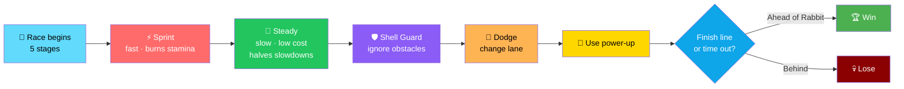
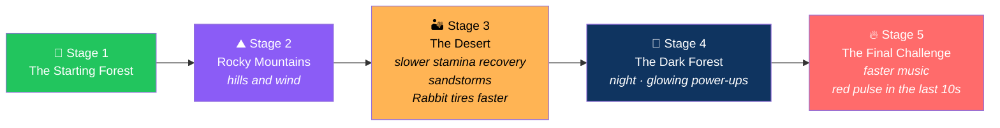
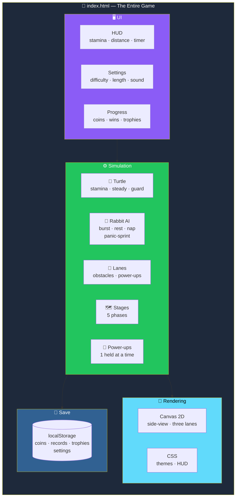

# 🐢 Turtle vs Rabbit: The Long Race

<div align="center">


**You are the Turtle. The Rabbit is faster, but it tires.**

*Win through discipline, not speed.*

[🚀 Run It](#-run-it) • [🎮 Controls](#-controls) • [✨ Skills](#-skills) • [🗺️ Stages](#-stages) • [🎁 Power-Ups](#-power-ups)

</div>

---

## 📖 Overview

**Turtle vs Rabbit: The Long Race** is a **browser racing game**.

You are the **Turtle**. The **Rabbit** is faster, but **it tires**.

### Core Idea

> **Win through discipline, not speed.**
>
> Sprint in short bursts. Guard your shell. Let the Rabbit lead early — then overtake it while it rests.

### The Race Flow



---

## 🚀 Run It

### 1. Unzip the Folder

### 2. Open `index.html`

**In any modern browser** — Chrome, Edge, Firefox, Safari.

> ✅ **No install, no server, no login. It works offline.**
>
> **The Baloo 2 font loads from Google Fonts when online and falls back to a standard font otherwise.**

---

## 🎯 Goal

**Be ahead of the Rabbit when time runs out — or reach the finish line first.**

### 📏 The Distance

> **The finish line sits at 200 m per minute of race length.**
>
> **Default: 1000 m for a 5-minute race.**

<div align="center">

| Race Length | Finish Line |
|:-----------:|:-----------:|
| **1 minute** | **200 m** |
| **2 minutes** | **400 m** |
| **3 minutes** | **600 m** |
| **5 minutes** | **1000 m** |
| **7 minutes** | **1400 m** |
| **10 minutes** | **2000 m** |

</div>

---

## 🎮 Controls

<div align="center">

| Action | Keyboard | Touch |
|--------|----------|-------|
| **Sprint** *(burns stamina fast)* | Hold **Space** | Hold **Sprint** |
| **Steady mode** | **Shift** | **Steady** |
| **Shell Guard** | **Q** | **Guard** |
| **Use held power-up** | **E** | **Use** |
| **Change lane** | **A / D**, **W / S**, or **arrow keys** | **Up / down buttons**, or **swipe** |
| **Pause** | **Esc** or **P** | **Pause button** *(top right)* |

</div>

> 💡 **The game also pauses automatically when the window loses focus.**

---

## ✨ Skills

### 🐢 The Turtle

**150 stamina · faster recovery**

<div align="center">

| Skill | Effect |
|:-----:|--------|
| **Steady** | **6 seconds** of steady pace · **low stamina cost** · **half the effect from slowdowns** · **Cooldown: 20 s** |
| **Shell Guard** | **4 seconds of armor** that **ignores every obstacle** · **Cooldown: 25 s** |

</div>

### 🐇 The Rabbit

**100 stamina**

<div align="center">

| Skill | Effect |
|:-----:|--------|
| **Burst** | **Very fast sprint** that **drains stamina quickly**, followed by **exhaustion** |
| **Dust Kick** | When the Rabbit **bursts past you at close range**, you are **slowed for ~1.3 s** — **Steady mode and Shell Guard block it** |

</div>

> 💡 **It also rests, naps when far ahead, and panic-sprints when you get close.**

---

## 🗺️ Stages

**Each stage is one fifth of the race time.**



---

## 🚧 Obstacles

**Logs · rocks · mud · puddles · cacti · bees**

> 💡 **They slow you down and cost stamina. Dodge them by changing lane.**

---

## 🎁 Power-Ups

> **Hold one at a time and activate it with `E`.**

<div align="center">

| Item | Effect |
|:----:|--------|
| 🥕 **Golden Carrot** | **Speed boost** for **4 s** |
| 🍃 **Energy Leaf** | **Restores 25 stamina** |
| 🐚 **Magic Shell** | **Blocks the next obstacle** |
| ⏰ **Golden Clock** | **Slows the Rabbit** for **6 s** |
| 🍄 **Lucky Mushroom** | **Random effect** from the four above |

</div>

---

## ⚙️ Settings

<div align="center">

| Setting | Options |
|:-------:|---------|
| **Difficulty** | **Easy · Normal · Hard · Expert** *(sets the Rabbit's speed)* |
| **Race length** | **1 · 2 · 3 · 5 · 7 · 10 minutes** |
| **Sound** | **Volume slider and mute** |
| **Reset progress** | **Clears coins, records, and trophies** |

</div>

---

## 📈 Progress

> **Coins, wins, personal-best distance** *(per difficulty and race length)*, **trophies, and settings** are saved in your browser's **localStorage**.
>
> **Clearing site data erases them.**

### 🏆 Trophies

<div align="center">

| Trophy | Requirement |
|:------:|-------------|
| **First Victory** | Win a race |
| **Clean Shell** | Win with **2 hits or fewer** |
| **Expert Winner** | Win on **Expert** difficulty |
| **Sprint Master** | **15 or more sprints** in a win |
| **Collector** | **6 or more power-ups** in a race |

</div>

---

## 💡 Tips

<div align="center">

| Tip | Why |
|-----|-----|
| **Sprint in short bursts** | Running out of stamina **halves your speed until you recover** |
| **Use Steady through mud, wind, and the desert** | It **halves the effect from slowdowns** and **costs less stamina** |
| **Save Shell Guard for a cluster of obstacles** | 4 seconds of **full immunity** |
| **Let the Rabbit lead early** | **It tires** — overtake it while it **rests or is exhausted** |

</div>

---

## 🏗️ Architecture

### System Overview



### Design Principles

<div align="center">

| Principle | Implementation |
|-----------|---------------|
| **📄 One file, zero dependencies** | The whole game is `index.html` — **portable, shareable, works offline** |
| **🐢 Discipline beats speed** | The Turtle's advantage is **stamina management, halved slowdowns, and invulnerability windows** — **not raw speed** |
| **🐇 The Rabbit is an opponent, not a script** | It **bursts, tires, rests, naps when far ahead, and panic-sprints when you get close** |
| **🚧 Obstacles are avoidable** | Three lanes, telegraphed spawns — **dodging is skill, not luck** |
| **🎁 Power-ups are consumables** | **One held at a time** — choosing when to use one is a decision, not a passive buff |
| **🗺️ Stages change the rules** | Each fifth of the race has its own **terrain, weather, and stamina dynamics** |
| **💾 Progress without a backend** | Coins, records, trophies, and settings live in **`localStorage`** |
| **🎮 Touch parity** | Every keyboard action has a touch equivalent |

</div>

---

## ⚠️ Not Included

> **Unlockable skins and a true 3D engine.**
>
> **The game is a side-view Canvas 2D game with three lanes.**

---

## 📁 Files

```
turtle-vs-rabbit/
└── index.html      # the whole game
                    # (HTML, CSS, and JavaScript in one file)
```

---

## 🗺️ Roadmap

### ✅ Current

- [x] Single-file, self-contained browser game
- [x] Works offline
- [x] Side-view Canvas 2D with three lanes
- [x] Sprint, Steady, Shell Guard, and lane-change controls
- [x] Keyboard and touch controls with parity
- [x] Automatic pause on window focus loss
- [x] Turtle stamina with faster recovery
- [x] Steady mode — 6 s of low cost and halved slowdowns, 20 s cooldown
- [x] Shell Guard — 4 s of full obstacle immunity, 25 s cooldown
- [x] Rabbit AI with burst, exhaustion, resting, napping, and panic-sprint
- [x] Dust Kick that slows you when the Rabbit bursts past at close range
- [x] Five stages — Starting Forest, Rocky Mountains, Desert, Dark Forest, Final Challenge
- [x] Stage-specific mechanics — hills and wind, slower stamina recovery in the desert, sandstorms, night with glowing power-ups, faster music and red pulse in the final 10 seconds
- [x] Six obstacle types — logs, rocks, mud, puddles, cacti, bees
- [x] Five power-ups — Golden Carrot, Energy Leaf, Magic Shell, Golden Clock, Lucky Mushroom
- [x] One held power-up at a time with `E` to activate
- [x] Difficulty settings — Easy, Normal, Hard, Expert
- [x] Race lengths from 1 to 10 minutes
- [x] Finish line at 200 m per minute of race length
- [x] Sound with volume slider and mute
- [x] Coins, wins, personal-best distance per difficulty and race length, trophies, and settings saved to localStorage
- [x] Reset progress setting
- [x] Five trophies — First Victory, Clean Shell, Expert Winner, Sprint Master, Collector
- [x] Tips documented for new players

### 🔜 Future Ideas

- [ ] **Unlockable skins** for the Turtle
- [ ] **A true 3D engine** — currently side-view Canvas 2D
- [ ] **Additional stages** beyond the current five
- [ ] **Additional power-ups**
- [ ] **Local leaderboards** per difficulty and race length
- [ ] **Ghost replay** — race your own best run
- [ ] **Daily challenge** with a fixed seed
- [ ] **Sound effects** — synthesized with Web Audio
- [ ] **Accessibility options** — reduced motion, larger HUD
- [ ] **Localization** — bilingual UI

---

## 🤝 Contributing

Contributions are welcome. Please:

1. Fork the repository
2. **Keep it single-file** — no external build step, no bundler
3. **Keep it dependency-free** — no frameworks, no assets
4. **Keep the discipline-over-speed design** — the Turtle must never become the fast one
5. **Keep the Rabbit unpredictable** — its AI should keep bursting, resting, and panicking
6. **Preserve the stage-specific rules** — each fifth of the race should feel different
7. **Keep power-ups consumable** — one held at a time
8. **Preserve localStorage compatibility** without a migration path
9. **Keep touch parity** — every keyboard action must have a touch equivalent
10. Submit a Pull Request

### Guidelines

- **Never make the Turtle faster than the Rabbit** — the game's thesis is discipline
- **Never remove the stamina penalty** — running out is the cost of sprinting
- **Never let obstacles be unavoidable** — three lanes are always there
- **Never add a required backend** — the game must work from `file://`
- **Never present a stub as a feature**

---

## 📜 License

MIT — see [LICENSE](LICENSE) for details.

---

## 🙏 Acknowledgments

- **Aesop** — for the fable this game is built on
- **Canvas 2D** — for making a full racing game possible in one file
- **Every underdog who ever won by pacing themselves** — this one's for you

---

<div align="center">

### 🐢 STEADY. GUARD. DODGE. WIN.

**You are the Turtle. The Rabbit is faster, but it tires.**

**Win through discipline, not speed.**

<br>

⭐ If this race made you think about pacing, consider giving it a star.

<br>

[⬆ Back to Top](#-turtle-vs-rabbit-the-long-race)

</div>
